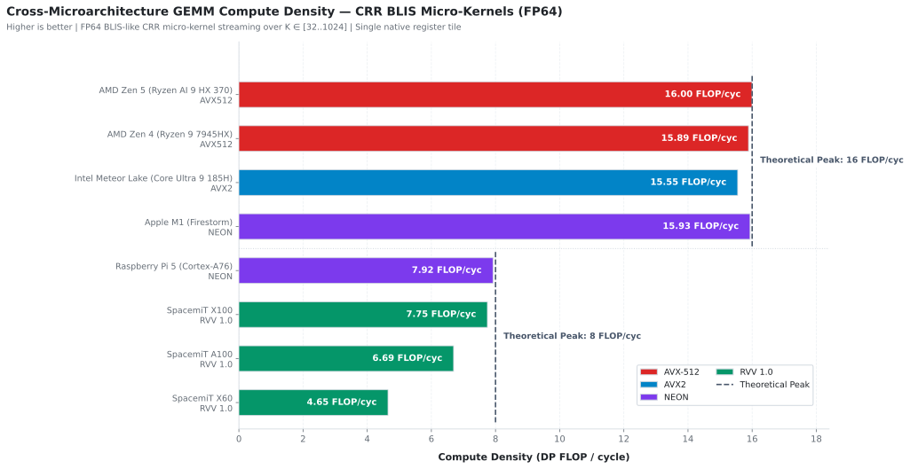
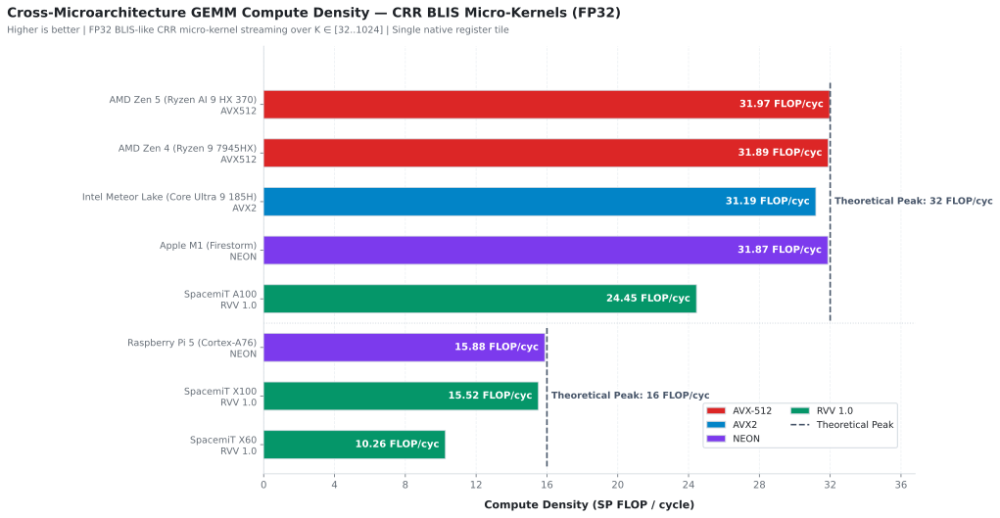
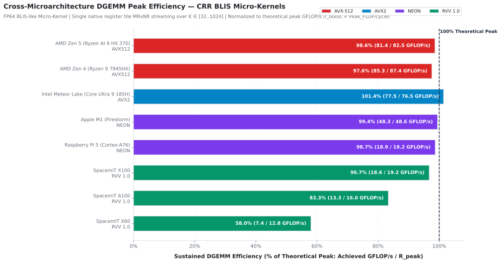
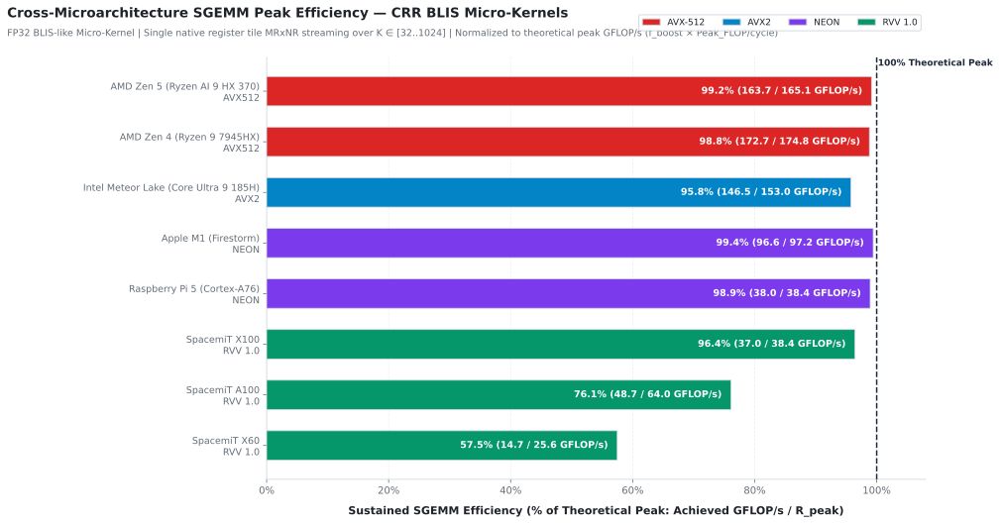

# GEMM Benchmark Suite Across Modern CPU Microarchitectures (MIPPv2)

> [!WARNING]
> **Work in progress (WIP)**: This repository is under active development. Anything might change w/o notice!

A double- and single-precision General Matrix Multiply (DGEMM / SGEMM) microbenchmark and exploration suite built on [MIPPv2](https://github.com/aff3ct/MIPP/tree/develop) (MyIntrinsics++ v2).

This suite evaluates FP64 and FP32 GEMM microkernels written in C++ with MIPPv2 across **9 CPU microarchitectures** and **4 SIMD ISAs**: **x86_64 AVX2 & AVX-512**, **AArch64 NEON**, and **RISC-V Vector 1.0** (RVV).

> [!NOTE]
> **Origins & context:** This benchmark was originally written as part of a research internship at **LIP6 (Sorbonne Université)**, focusing on the design, implementation, and benchmarking of **RISC-V Vector 1.0 (RVV)** support for MIPPv2 on the **SpacemiT X100 architecture** and **AVX2** on the **Intel Skylake architecture**.

---

## Microarchitectural Evaluation & Results

The suite evaluates single-core, compute-bound FP64 (DGEMM) and FP32 (SGEMM) microkernels under the **CRR layout** (GotoBLAS / BLIS convention: column-major packed $A$ panel with leading dimension $M_R$, row-major $B$, row-major $C$). In the benchmark we iterate panel depth $K \in [32..1024]$ with register tiles ($M_R \times N_R$) empirically selected to maximize throughput on each target microarchitecture.

### 1. Compute Density (FLOP / cycle)

Figure 1 evaluates microarchitectural execution efficiency, measuring floating-point operations completed per clock cycle:

<p align="center">
  
</p>

<p align="center">
  
</p>

### 2. Sustained GEMM Efficiency (% of Theoretical Peak GFLOP/s)

Figure 2 reports sustained throughput relative to rated single-core frequency ceilings ($R_{\text{achieved}} / R_{\text{peak}} \times 100$):

<p align="center">
  
</p>

<p align="center">
  
</p>

### Microarchitectural Hardware Execution Summary

The tables below present execution unit pipeline saturation with rated system throughput by measuring effective operating frequency ($f_{\text{eff}} = \text{Cycles} / \text{Time}$) via Linux `perf_event_open` hardware cycle counters alongside rated burst clocks ($f_{\text{peak}}$):

#### Double-Precision (FP64 / DGEMM)

| SIMD | Microarchitecture | CPU Model | Champion Kernel | Tile ($M_R \times N_R$) | Comp | Pipe Saturation (%) | FLOP/cycle | $f_{\text{eff}}$ (GHz) | $f_{\text{peak}}$ (GHz) | Achieved (GFLOP/s) | Peak Theo (GFLOP/s) | % Peak Theo |
|:---|:---|:---|:---|:---:|:---:|:---:|:---:|:---:|:---:|:---:|:---:|:---:|
| AVX512 | AMD Zen 5 Strix Point | Ryzen AI 9 HX 370 | `mippv2_firestorm_mr4_nr4_fmaddi_crr` | 4x32 | gcc | **100.0%** | 16.00 / 16 | 5.10 | 5.16 | 81.6 | 82.5 | 98.9% |
| AVX512 | AMD Zen 4 | Ryzen 9 7945HX | `mippv2_firestorm_mr4_nr4_fmaddi_crr` | 4x32 | gcc | **99.7%** | 15.95 / 16 | 5.35 | 5.46 | 85.3 | 87.4 | 97.6% |
| AVX2 | Intel Meteor Lake | Core Ultra 9 185H | `mippv2_meteorlake_mr4_nr3_crr` | 4x12 | clang | **96.5%** | 15.43 / 16 | 4.77 | 4.78 | 73.6 | 76.5 | 96.2% |
| AVX2 | Intel Skylake | i5-6200U | `mippv2_meteorlake_mr4_nr3_crr` | 4x12 | clang | **96.2%** | 15.39 / 16 | 2.28 | 2.30 | 35.1 | 36.8 | 95.5% |
| NEON | Apple M1 | Firestorm | `mippv2_x60_mr6_nr4_fmaddi_crr` | 6x8 | gcc | **99.6%** | 15.93 / 16 | 3.03 | 3.04 | 48.3 | 48.6 | 99.4% |
| NEON | Raspberry Pi 5 | Cortex-A76 | `mippv2_a76_mr6_nr4_fmaddi_crr` | 6x8 | gcc | **99.1%** | 7.93 / 8 | 2.39 | 2.40 | 19.0 | 19.2 | 98.7% |
| RVV | SpacemiT X100 | SpacemiT X100 | `mippv2_x100_register_blocked_apack4_crr` | 3x16 | clang | **96.5%** | 7.72 / 8 | 2.40 | 2.40 | 18.5 | 19.2 | 96.4% |
| RVV | SpacemiT A100 | SpacemiT A100 | `mippv2_a100_mr7_nr2_lmul2_pipe_crr` | 7x64 | gcc | **83.7%** | 6.69 / 8 | 1.99 | 2.00 | 13.3 | 16.0 | 83.3% |
| RVV | SpacemiT X60 | SpacemiT X60 | `mippv2_a100_mr7_nr4_pipe_crr` | 7x16 | clang | **58.1%** | 4.65 / 8 | 1.60 | 1.60 | 7.4 | 12.8 | 58.0% |

#### Single-Precision (FP32 / SGEMM)

| SIMD | Microarchitecture | CPU Model | Champion Kernel | Tile ($M_R \times N_R$) | Comp | Pipe Saturation (%) | FLOP/cycle | $f_{\text{eff}}$ (GHz) | $f_{\text{peak}}$ (GHz) | Achieved (GFLOP/s) | Peak Theo (GFLOP/s) | % Peak Theo |
|:---|:---|:---|:---|:---:|:---:|:---:|:---:|:---:|:---:|:---:|:---:|:---:|
| AVX512 | AMD Zen 5 Strix Point | Ryzen AI 9 HX 370 | `mippv2_firestorm_mr4_nr4_fmaddi_crr` | 4x64 | gcc | **100.0%** | 31.99 / 32 | 5.12 | 5.16 | 163.7 | 165.1 | 99.2% |
| AVX512 | AMD Zen 4 | Ryzen 9 7945HX | `mippv2_firestorm_mr4_nr4_fmaddi_crr` | 4x64 | gcc | **99.6%** | 31.87 / 32 | 5.42 | 5.46 | 172.7 | 174.8 | 98.8% |
| AVX2 | Intel Meteor Lake | Core Ultra 9 185H | `mippv2_meteorlake_mr4_nr3_crr` | 4x24 | clang | **96.5%** | 30.89 / 32 | 4.74 | 4.78 | 146.5 | 153.0 | 95.8% |
| NEON | Apple M1 | Firestorm | `mippv2_x60_mr6_nr4_fmaddi_crr` | 6x16 | gcc | **99.6%** | 31.87 / 32 | 3.03 | 3.04 | 96.6 | 97.2 | 99.4% |
| NEON | Raspberry Pi 5 | Cortex-A76 | `mippv2_a76_mr6_nr4_fmaddi_crr` | 6x16 | gcc | **99.3%** | 15.89 / 16 | 2.39 | 2.40 | 38.0 | 38.4 | 98.9% |
| RVV | SpacemiT X100 | SpacemiT X100 | `mippv2_x100_register_blocked_apack4_crr` | 3x32 | clang | **96.6%** | 15.45 / 16 | 2.40 | 2.40 | 37.0 | 38.4 | 96.4% |
| RVV | SpacemiT A100 | SpacemiT A100 | `mippv2_a100_mr7_nr2_lmul2_pipe_crr` | 7x128 | clang | **76.4%** | 24.44 / 32 | 1.99 | 2.00 | 48.7 | 64.0 | 76.1% |
| RVV | SpacemiT X60 | SpacemiT X60 | `mippv2_x60_mr6_nr4_fmaddi_crr` | 6x32 | clang | **64.2%** | 10.27 / 16 | 1.60 | 1.60 | 16.4 | 25.6 | 64.1% |

> [!NOTE]
> **Zen 5 Mobile Datapath Ceiling:** Mobile Zen 5 (Strix Point / Ryzen AI 9 HX 370) implements dual 256-bit physical FMA datapaths (double-pumped 512-bit execution), establishing a physical ceiling of 16 DP / 32 SP FLOP/cycle (identical to Zen 4), rather than the 32 DP / 64 SP FLOP/cycle dual 512-bit pipes of desktop/server Zen 5.

> **Microarchitectural Observations:**
> - **Out-of-Order Execution Efficiency:** Apple M1 (Firestorm), AMD Zen 4, AMD Zen 5 (Strix Point), and ARM Cortex-A76 achieve $\ge 99\%$ pipeline issue saturation in both FP64 and FP32, indicating balanced register tiling and effective memory latency hiding in L1 cache across diverse out-of-order execution engines.
> - **Sustained Vector Clock Roll-Off on Modern x86 (Zen 4 & Meteor Lake):** Under continuous dense vector FMA execution, power management envelopes (AMD Precision Boost / Intel Speed Shift) stabilize operating frequencies below light-load burst ceilings:
>   - On **AMD Zen 4** (Ryzen 9 7945HX), sustained 512-bit execution settles at $f_{\text{eff}} = 5.35\text{–}5.42\text{ GHz}$ (vs $f_{\text{peak}} = 5.46\text{ GHz}$ burst), accounting for the entire gap to theoretical peak throughput despite near-perfect (99.6–99.7%) pipeline saturation.
>   - On **Intel Meteor Lake** (Core Ultra 9 185H), dense 256-bit AVX2 execution stabilizes Redwood Cove P-cores at $f_{\text{eff}} = 4.74\text{–}4.77\text{ GHz}$ (calibrated via `cpufp`) rather than the 5.10 GHz light-load burst ceiling.
> - **In-Order Sensitivity & Microkernel Scheduling (RISC-V Vector):** On out-of-order engines (e.g. SpacemiT X100 at 7.72 DP / 15.45 SP FLOP/cycle, 96.6% saturation), dynamic hardware scheduling acts as a tolerance buffer, absorbing instruction-level latencies and allowing portable C++ kernels to reach near-peak throughput. Conversely, on in-order dual-issue pipelines (SpacemiT X60 and A100), this hardware safety net vanishes: any scheduling sub-optimality in the C++ assembly produced by the compiler lowers execution efficiency, limiting our current portable MIPPv2 kernels to 58.1% DP / 64.2% SP on X60 and 83.7% DP / 76.4% SP on A100. As evidenced by hand-tuned assembly kernels reaching up to 6.43 DP / 13.45 SP FLOP/cycle on the X60 (Section 3), high compute density on in-order vector cores remains achievable, but demands cycle-accurate static scheduling that cannot yet be effortlessly offloaded to high-level abstractions.

---

### 3. Native BLIS Assembly vs. Portable MIPPv2 C++ Comparison

To establish an empirical baseline against industry-standard hand-tuned kernels, GEMMBench evaluates MIPPv2 against reference assembly microkernels from the upstream [FLAME BLIS framework](https://github.com/flame/blis) and community ports ([Stepan Nassyr's SpacemiT X60 port](https://github.com/stepannassyr/blis/tree/x60/kernels)):

| Architecture / SIMD | Precision | Reference Assembly Kernel | Geometry ($M_R \times N_R$) | Source Repository & Attribution |
| :--- | :---: | :--- | :---: | :--- |
| **x86-64 AVX-512** (Zen 4, Zen 5) | DP / SP | `skx_d16x14.c` / `skx_s32x12.c` | $16 \times 14$ / $32 \times 12$ | [flame/blis](https://github.com/flame/blis/tree/a8037cfc4330030c726efaec1ffeb1f93d468aa3) (`a8037cf`, Upstream) |
| **x86-64 AVX2** (Meteor Lake, Skylake) | DP / SP | `haswell_d6x8.c` (`d6x8` / `s6x16`) | $6 \times 8$ / $6 \times 16$ | [flame/blis](https://github.com/flame/blis/tree/a8037cfc4330030c726efaec1ffeb1f93d468aa3) (`a8037cf`, Upstream / AMD) |
| **AArch64 NEON** (M1, Cortex-A76) | DP / SP | `armv8a_d6x8.c` (`d6x8` / `s8x12`) | $6 \times 8$ / $8 \times 12$ | [flame/blis](https://github.com/flame/blis/tree/a8037cfc4330030c726efaec1ffeb1f93d468aa3) (`a8037cf`, Upstream) |
| **RISC-V Vector 1.0** (SpacemiT X60) | DP / SP | `dgemm_x60_2vx14.c` / `sgemm_x60_2vx14.c` | $8 \times 14$ / $16 \times 14$ | [stepannassyr/blis (`x60`)](https://github.com/stepannassyr/blis/tree/6ffc1d35fcafe74788b2aeaf00d5792d2618e0b9/kernels/x60) (`6ffc1d3`, Stepan Nassyr) |

#### Comprehensive Summary & Methodological Ablations

> [!IMPORTANT]
> The full, canonical cross-architecture synthesis across all 4 experimental variants (`default`, `nofp`, `coldc`, `strict`) is available in:
> 📄 **[gemm-bench-results/paper_v1/SUMMARY.md](gemm-bench-results/paper_v1/SUMMARY.md)**

#### Synthesis Table: Matched-$K$ Window Ratio ($K \in [128, 384]$)

The table below presents the geometric mean throughput ratio ($\text{geomean}(R_K)$) evaluated at identical panel depths $K \in [128, 384]$ over 3 independent process runs $\times$ 15 repetitions (`≈`: 95% CI overlaps $[0.98, 1.02]$ at all $K$; `+`: strict MIPPv2 advantage $\text{CI}_{\text{low}} > 1.02$ at all $K$; `-`: strict BLIS advantage $\text{CI}_{\text{high}} < 0.98$ at all $K$; `±`: mixed transition regime across $K$ in window):

| Platform | Compiler | Prec. | MIPPv2 Champion | Default | No-FastPath | Cold-C | Strict IEEE (FP32) |
| :--- | :--- | :---: | :--- | :---: | :---: | :---: | :---: |
| `zen4_avx512` | `gcc` | FP64 | `mippv2_firestorm_mr4_nr4_fmaddi_crr` | **100.8%** ≈ | **100.6%** ≈ | **97.3%** ± | — |
| `zen4_avx512` | `clang` | FP64 | `mippv2_firestorm_mr4_nr4_fmaddi_crr` | **100.8%** ≈ | **100.7%** ≈ | **98.0%** ± | — |
| `zen4_avx512` | `gcc` | FP32 | `mippv2_firestorm_mr4_nr4_fmaddi_crr` | **100.9%** ≈ | **100.7%** ≈ | **99.6%** ≈ | **100.9%** ≈ |
| `zen4_avx512` | `clang` | FP32 | `mippv2_firestorm_mr4_nr4_fmaddi_crr` | **100.6%** ≈ | **100.7%** ≈ | **99.3%** ≈ | **100.6%** ≈ |
| `zen5_avx512` | `gcc` | FP64 | `mippv2_firestorm_mr4_nr4_fmaddi_crr` | **100.5%** ≈ | **100.5%** ≈ | **100.5%** ≈ | — |
| `zen5_avx512` | `clang` | FP64 | `mippv2_firestorm_mr4_nr4_fmaddi_crr` | **100.5%** ≈ | **100.5%** ≈ | **100.5%** ≈ | — |
| `zen5_avx512` | `gcc` | FP32 | `mippv2_firestorm_mr4_nr4_fmaddi_crr` | **100.5%** ≈ | **100.5%** ≈ | **100.6%** ≈ | **100.5%** ≈ |
| `zen5_avx512` | `clang` | FP32 | `mippv2_firestorm_mr4_nr4_fmaddi_crr` | **100.5%** ≈ | **100.5%** ≈ | **100.5%** ≈ | **100.5%** ≈ |
| `meteorlake_avx2` | `gcc` | FP64 | `mippv2_meteorlake_mr4_nr3_crr` | **91.2%** - | **91.1%** - | **91.2%** - | — |
| `meteorlake_avx2` | `clang` | FP64 | `mippv2_meteorlake_mr4_nr3_crr` | **99.5%** ≈ | **99.5%** ≈ | **100.4%** ≈ | — |
| `meteorlake_avx2` | `gcc` | FP32 | `mippv2_meteorlake_mr4_nr3_crr` | **98.6%** ≈ | **98.5%** ± | **96.1%** ± | **97.8%** ± |
| `meteorlake_avx2` | `clang` | FP32 | `mippv2_meteorlake_mr4_nr3_crr` | **100.8%** ≈ | **100.8%** ≈ | **100.8%** ≈ | **100.8%** ≈ |
| `m1_neon` | `gcc` | FP64 | `mippv2_x60_mr6_nr4_fmaddi_crr` | **101.7%** ± | **101.6%** ± | **101.8%** ± | — |
| `m1_neon` | `clang` | FP64 | `mippv2_x60_mr6_nr4_fmaddi_crr` | **101.4%** ± | **101.5%** ± | **101.5%** ± | — |
| `m1_neon` | `gcc` | FP32 | `mippv2_x60_mr6_nr4_fmaddi_crr` | **101.8%** ± | **101.8%** ± | **102.0%** ± | **101.8%** ± |
| `m1_neon` | `clang` | FP32 | `mippv2_x60_mr6_nr4_fmaddi_crr` | **101.5%** ± | **101.5%** ± | **101.7%** ± | **101.5%** ± |
| `rpi5_neon` | `gcc` | FP64 | `mippv2_a76_mr6_nr4_fmaddi_crr` | **101.9%** ± | **102.1%** ± | **102.1%** ± | — |
| `rpi5_neon` | `clang` | FP64 | `mippv2_a76_mr6_nr4_fmaddi_crr` | **101.7%** ± | **101.5%** ± | **100.5%** ≈ | — |
| `rpi5_neon` | `gcc` | FP32 | `mippv2_a76_mr6_nr4_fmaddi_crr` | **102.1%** ± | **102.0%** ± | **102.3%** ± | **102.0%** ± |
| `rpi5_neon` | `clang` | FP32 | `mippv2_a76_mr6_nr4_fmaddi_crr` | **101.6%** ± | **101.6%** ± | **99.8%** ≈ | **101.6%** ± |
| `x100_rvv` | `gcc` | FP64 | `mippv2_x100_register_blocked_apack4_crr` | **90.5%** - | **88.8%** - | **90.1%** - | — |
| `x100_rvv` | `clang` | FP64 | `mippv2_x100_register_blocked_apack4_crr` | **103.0%** ± | **101.5%** ± | **105.9%** + | — |
| `x100_rvv` | `gcc` | FP32 | `mippv2_x100_register_blocked_apack4_crr` | **90.3%** - | **89.6%** - | **90.5%** - | **90.4%** - |
| `x100_rvv` | `clang` | FP32 | `mippv2_x100_register_blocked_apack4_crr` | **102.5%** ± | **102.6%** ± | **106.4%** + | **102.5%** ± |
| `a100_rvv` | `gcc` | FP64 | `mippv2_a100_mr7_nr2_lmul2_pipe_crr` | **367.3%** + | **366.1%** + | **365.9%** + | — |
| `a100_rvv` | `clang` | FP64 | `mippv2_a100_mr7_nr2_lmul2_pipe_crr` | **352.6%** + | **349.8%** + | **355.8%** + | — |
| `a100_rvv` | `gcc` | FP32 | `mippv2_a100_mr7_nr2_lmul2_pipe_crr` | **333.0%** + | **333.0%** + | **336.1%** + | **336.0%** + |
| `a100_rvv` | `clang` | FP32 | `mippv2_a100_mr7_nr2_lmul2_pipe_crr` | **359.6%** + | **359.8%** + | **367.5%** + | **360.0%** + |
| `x60_rvv` | `gcc` | FP64 | `mippv2_a100_mr7_nr4_pipe_crr` | **78.3%** - | **79.6%** - | **80.4%** - | — |
| `x60_rvv` | `clang` | FP64 | `mippv2_a100_mr7_nr4_pipe_crr` | **83.7%** - | **84.5%** - | **87.7%** - | — |
| `x60_rvv` | `gcc` | FP32 | `mippv2_x60_mr6_nr4_fmaddi_crr` | **66.5%** - | **66.7%** - | **66.8%** - | **65.6%** - |
| `x60_rvv` | `clang` | FP32 | `mippv2_x60_mr6_nr4_fmaddi_crr` | **74.0%** - | **72.8%** - | **74.9%** - | **74.9%** - |

Detailed analytical reports with 95% bootstrap confidence intervals and working-set footprints:
- [Default FP64 Report](gemm-bench-results/paper_v1/report_fp64_default.md) | [Default FP32 Report](gemm-bench-results/paper_v1/report_fp32_default.md)
- [No-FastPath FP64 Report](gemm-bench-results/paper_v1/report_fp64_nofp.md) | [No-FastPath FP32 Report](gemm-bench-results/paper_v1/report_fp32_nofp.md)
- [Cold-C FP64 Report](gemm-bench-results/paper_v1/report_fp64_coldc.md) | [Cold-C FP32 Report](gemm-bench-results/paper_v1/report_fp32_coldc.md)
- [Strict IEEE FP32 Report](gemm-bench-results/paper_v1/report_fp32_strict.md)

---

### Threats to Validity

1. **Isolated Micro-Kernel Scope vs. Macro-Kernel Framework:**
   Measurements focus strictly on the computational GEMM micro-kernel ($C_{MR \times NR} += A_{MR \times K} \cdot B_{K \times NR}$) operating on pre-packed panel buffers residing in L1/L2 cache. This methodology follows Goto & van de Geijn (2008) and Van Zee & van de Geijn (2015), isolating vector compute density from macro-kernel cache partitioning, multi-threaded work distribution, and dynamic memory packing.
2. **Asymmetric Tile Geometries & Cache Footprints:**
   BLIS reference kernels employ specific microarchitecture-tuned register blockings ($16 \times 14$ DP / $32 \times 12$ SP on AVX-512 `skx`, $6 \times 8$ DP / $6 \times 16$ SP on AVX2 `haswell`, $6 \times 8$ DP / $8 \times 12$ SP on NEON `armv8a`, and $8 \times 14$ DP / $16 \times 14$ SP on RVV `x60`), whereas MIPPv2 champions use platform-parameterized register tilings ($4 \times 4$ vectors on AVX-512, $4 \times 3$ on AVX2, $6 \times 4$ on NEON, $3 \times 2$ `apack4` on X100, $7 \times 2$ `lmul2` on A100). As detailed in the reports, working set footprints differ across implementations and are marked with `†` when exceeding L1d cache boundaries.
3. **Upstream BLIS Baseline Availability on RISC-V & SpacemiT K3 Scheduling:**
   Upstream BLIS provides no native 1024-bit vector microkernel for SpacemiT A100 nor an out-of-order tuned microkernel for SpacemiT X100. Both evaluate the 256-bit X60 community kernel by Stepan Nassyr, under-utilizing A100's wide 1024-bit VPU. On SpacemiT K3 (`a100`), threads are migrated to the AI core cluster (`cpu8..15`) via `/proc/set_ai_thread`; primary `FLOP/cycle` ratios are derived directly from per-thread hardware cycle counters (`PERF_COUNT_HW_CPU_CYCLES`).
4. **Pre-Registered Champion Selection:**
   To guard against post-hoc selection bias across exploratory kernel variants, MIPPv2 champions are pre-registered prior to benchmarking in `uarch_config.json`. The post-hoc best-compiler envelope across GCC and Clang is reported strictly as a secondary reference in the report appendix.

---

### Methodological Scope & Measurement Protocol

To ensure reproducibility and isolate microarchitectural behavior, the benchmark suite enforces the following constraints:

1. **In-Cache Register Tile Scope**:
   - Evaluates the innermost $K$-loop on pre-packed panels $A$ ($M_R \times K$, column-major) and $B$ ($K \times N_R$, row-major) accumulating into an in-register tile ($M_R \times N_R$) and writing to $C$.
   - Cache-blocking hierarchy overheads (GotoBLAS / BLIS: $J_C, P_C, I_C, J_R, I_R$) and dynamic matrix packing into memory buffers are excluded.
2. **Canonical GEMM Regime**:
   - Evaluates the compute-bound canonical form $\alpha = 1.0, \beta = 0.0$ ($C \leftarrow AB$), where throughput is computed as $\text{GFLOP/s} = \frac{2 \times M \times N \times K}{\text{Time (seconds)} \times 10^9}$. Non-canonical operations ($\beta \neq 0.0$) introduce load-scale-accumulate overheads on $C$ that are validated functionally (and measurable via `--no-fastpath`) but excluded from default peak throughput claims.
3. **Tile Geometry & Boundary Conditions**:
   - Panel dimensions $M, N$ match the register tile $M_R, N_R$. Kernels include scalar/vector fringe handling for functional correctness; edge handling is excluded from peak saturation measurements.
4. **Single-Thread IEEE-754 FP64 & FP32 Scope**:
   - Measurements evaluate single-thread IEEE-754 double precision (`double` / FP64, default) and single precision (`float` / FP32, via `--fp32`).
5. **Multi-Repetition Sampling & Median Filtering**:
   - Each measurement collects $R = 15$ timed samples over hundreds of thousands to millions of kernel invocations. Timings report the median duration alongside standard deviation and intra-run coefficient of variation ($\text{CV} = \frac{\sigma}{\mu} \times 100\,\%$).
6. **Multi-Run Replication & Inter-Run CV Monitoring**:
   - Benchmarks execute $N_{\text{runs}} = 3$ independent processes per configuration. An automatic warning is raised if inter-run variation exceeds 5%.
7. **Compiler Optimization & Monotonic Timing Barriers**:
   - Monotonic timestamps (`std::chrono::steady_clock::now()`) are isolated by `asm volatile("" ::: "memory")` compiler barriers. Dead-code elimination is prevented via clobbered read barriers on matrix pointers (`asm volatile("" :: "r"(C.data) : "memory")`).
8. **Hardware Cycle Counting via `perf_event_open`**:
   - On Linux systems, unprivileged hardware performance counters (`PERF_COUNT_HW_CPU_CYCLES`) record exact CPU cycles elapsed during the timed loop, computing true $\text{FLOP/cycle} = \frac{2 \times M \times N \times K}{\text{Cycles}}$ and effective operating frequency ($f_{\text{eff}} = \frac{\text{Cycles}}{\text{Time} \times 10^9}$).
9. **Platform Isolation & Thermal Management**:
   - Processes are pinned to a dedicated physical core via `taskset`. Thermal cooldown pauses ($2.0\,\text{s}$) are inserted between sizes for $K \ge 256$ to mitigate heat accumulation. Core frequency is passively monitored via `cpufreq/scaling_cur_freq` to detect throttling.
10. **Numerical Validation**:
    - Microkernel correctness is validated against a pure scalar IEEE-754 FP64 reference via the `--validate` flag and automated Catch2 unit tests (`GemmBenchTests`).

---

## Prerequisites & Building

### 1. Requirements
- **C++20 Compiler**: `g++` (>= 12.0) or `clang++` (>= 15.0).
- **CMake**: version 3.20 or newer.
- **Python**: 3.9+ with `matplotlib`, `pandas`, `numpy`.
- **MIPPv2 Headers**: Obtain the headers from the [MIPP develop branch](https://github.com/aff3ct/MIPP/tree/develop) or download from [MIPP Releases](https://github.com/aff3ct/MIPP/releases).

### 2. Build & Unit Tests
```bash
# Standard build (enables native BLIS reference kernels by default)
cmake -B build -S . \
  -DCMAKE_BUILD_TYPE=Release \
  -DMIPPV2_INCLUDE_DIR=/path/to/mipp/include

cmake --build build -j$(nproc)

# (Optional) Build and run Catch2 unit tests
cmake -B build -S . \
  -DCMAKE_BUILD_TYPE=Release \
  -DMIPPV2_INCLUDE_DIR=/path/to/mipp/include \
  -DGEMMBENCH_BUILD_TESTS=ON

cmake --build build -j$(nproc)
ctest --test-dir build --output-on-failure
```

| CMake Option | Default | Description |
| :--- | :--- | :--- |
| `-DGEMMBENCH_ENABLE_BLIS` | `ON` | Compile and link native BLIS reference assembly microkernels (`blis_native`) |
| `-DGEMMBENCH_BLIS_TARGET` | `AUTO` | Explicit target override: `AUTO`, `SKX` (AVX-512), `HASWELL` (AVX2), `ARMV8A` (NEON), `X60` (RVV) |
| `-DGEMMBENCH_BUILD_TESTS` | `OFF` | Build Catch2 unit test suite (`GemmBenchTests`) |
| `-DGEMMBENCH_ENABLE_FASTMATH` | `ON` | Fast math flags (`-ffast-math`). Use `OFF` for strict IEEE-754 mode (`-ffp-contract=fast`) |
| `-DGEMMBENCH_ENABLE_EXPLO` | `OFF` | Enable exploratory experimental microkernel implementations |

---

## Running Benchmarks

Benchmarks are driven by `./run_benchmarks.sh <platform> [options] [compilers...]`.

Always specify `-o <uarch>_<simd>` to ensure non-colliding, standardized result files:

```bash
# Benchmark Intel Skylake (AVX2) with GCC and Clang
./run_benchmarks.sh avx2 -o skylake_avx2 gcc clang

# Benchmark Intel Meteor Lake (AVX2) on specific matrix sizes
./run_benchmarks.sh avx2 -o meteorlake_avx2 -s 32 -s 64 -s 96 -s 128 gcc clang

# Benchmark AMD Zen 4 (AVX-512) pinned to core 0 with 15 repetitions and 3 runs
./run_benchmarks.sh avx512 -o zen4_avx512 -c 0 -r 15 --runs 3 gcc clang

# Benchmark SpacemiT X100 with clean rebuild
./run_benchmarks.sh rvv_x100 -o x100_rvv --rebuild clang

# Benchmark CRR kernels only (BLIS-like K sweep on native MR×NR tile) in FP64 and FP32
./run_benchmarks.sh avx512 --crr -o zen4_avx512 gcc clang
./run_benchmarks.sh avx512 --crr --fp32 -o zen4_avx512 gcc clang

# Full list of options
./run_benchmarks.sh --help
```

---

## Plotting & Performance Analysis

All figures are generated as **SVG** graphics:

`plot_results_crr.py` analyzes CRR micro-kernel benchmark results with automatic champion selection and FLOP/cycle efficiency. It can optionally generate side-by-side comparisons against RRR baselines:

```bash
# Generate all FP64 CRR plots (auto-detects gemm-bench-results/crr/)
python3 plot_results_crr.py --output plots_crr

# Generate all FP32 CRR plots (auto-detects gemm-bench-results/crr_fp32/)
python3 plot_results_crr.py --fp32 --output plots_crr_fp32

# With side-by-side CRR vs RRR comparison
python3 plot_results_crr.py --output plots_crr --compare-rrr gemm-bench-results

# Filter specific architectures
python3 plot_results_crr.py --uarch zen4 m1 x100 --output plots_crr
```

### RRR Plots

```bash
# Generate all RRR plots from reference datasets
python3 plot_results.py --input-dir gemm-bench-results --output plots

# Filter specific architectures or SIMD extensions
python3 plot_results.py --input-dir gemm-bench-results --uarch zen4 zen5 m1
python3 plot_results.py --input-dir gemm-bench-results --simd avx512 neon

# Override clock frequencies (in GHz) for dynamic boost clock analysis
python3 plot_results.py --input-dir gemm-bench-results --freq zen4=5.4,m1=3.0
```


### Output Artifacts

- **`plots_crr/` & `plots_crr_fp32/` (Primary — CRR Tile Layout, FP64 & FP32)**:
  - `cross_uarch_crr_flop_cycle_comparison.svg`: Compute density (FLOP/cycle) across architectures against hardware issue ceilings.
  - `cross_uarch_crr_efficiency_comparison.svg`: Pipeline saturation (% of theoretical peak GFLOP/s).
  - `cross_uarch_crr_vs_rrr_comparison.svg`: Relative speedup of CRR over the legacy RRR baseline (with `--compare-rrr`).
  - `<simd>_<uarch>_crr_overview.svg`: Per-architecture scaling curves across $K \in [32..1024]$ and compilers.
  - `crr_hardware_summary_table.md`: Hardware execution and pipeline saturation summary table.

- **`gemm-bench-results/blis_comparison/plots/` & `plots_blis_fp32/` (MIPPv2 vs BLIS Assembly, FP64 & FP32)**:
  - `blis_vs_mippv2_ratio_comparison.svg`: Sustained throughput ratio (% of BLIS Peak).
  - `blis_vs_mippv2_flop_per_cycle_comparison.svg`: Compute density comparison (FLOP/cycle vs theoretical limits).
  - `blis_vs_mippv2_k_scaling_grid.svg`: Multi-architecture scaling curves across $K \in [32..1024]$.

- **`plots/` (Legacy — RRR Baseline)**:
  - `cross_uarch_flop_cycle_comparison.svg`: Compute density (DP FLOP/cycle) across architectures.
  - `cross_uarch_efficiency_comparison.svg`: Pipeline saturation (% of theoretical peak GFLOP/s).
  - `<simd>_<uarch>_overview.svg`: Per-architecture scaling curves across square matrix sizes $N \in [32..128]$.

## Adding a New Microkernel

Interested in adding a new register tile geometry, a specialized ISA kernel, or porting to a new target?  
Refer to the step-by-step guide: [**Developer Tutorial: Adding a New Microkernel**](docs/adding_a_microkernel.md).

---

## Acknowledgments & Third-Party Credits

- **The FLAME Project / BLIS** ([flame/blis](https://github.com/flame/blis)): The University of Texas at Austin and contributors for the open-source BLIS framework and the hand-tuned x86-64 (AVX2, AVX-512) and AArch64 (NEON) reference assembly microkernels (tracked commit [`a8037cf`](https://github.com/flame/blis/commit/a8037cfc4330030c726efaec1ffeb1f93d468aa3)).
- **Stepan Nassyr** ([@stepannassyr](https://github.com/stepannassyr)): For porting BLIS to RISC-V Vector 1.0, and creating/tuning the dedicated SpacemiT X60 assembly microkernels (`dgemm_x60_2vx14.c`, `sgemm_x60_2vx14.c`) via `asmgen-gemm` in the [`stepannassyr/blis`](https://github.com/stepannassyr/blis/tree/x60/kernels) repository (`x60` branch, tracked commit [`6ffc1d3`](https://github.com/stepannassyr/blis/commit/6ffc1d35fcafe74788b2aeaf00d5792d2618e0b9)).
- **MIPP / MIPPv2**: Adrien Cassagne and the AFF3CT / LIP6 team for the MyIntrinsics++ portable vectorization wrapper.
- **Adrien Cassagne** ([@kouchy](https://github.com/kouchy/)) for access to the single-board computers (SBCs) and nodes on the [Dalek Cluster](https://dalek.proj.lip6.fr/) (*"Dalek: An Unconventional and Energy-Aware Heterogeneous Cluster"*, [arXiv:2508.10481](https://arxiv.org/abs/2508.10481)).
- **SpacemiT**, for the [SpacemiT K3 Technical Whitepaper](https://forum.spacemit.com/uploads/short-url/60aJ8cYNmrFWqHn4ddwwSzMLjlY.pdf).
- **camel-cdr**, for the [RVV Benchmark Results](https://camel-cdr.github.io/rvv-bench-results/index.html) project.
- The authors of *["Great Expectations: Benchmarking the Real-World Performance of RVV 1.0 in HPC"](https://arxiv.org/abs/2608.28097)* ([arXiv:2608.28097](https://arxiv.org/abs/2608.28097)).

---

## Generative AI Disclosure

Generative AI assistants (**Google Gemini** and **OpenAI ChatGPT**) were utilized during the development of this repository to accelerate boilerplate tasks (mechanical C++ tile variations, shell and Python plotting scripts, CLI argument handling, and test fixtures). All microarchitectural design decisions—including CRR layout selection, register file budgeting ($M_R \times N_R$) to prevent spilling and RAW stalls, and empirical hardware benchmarking—were directed, validated, and optimized by the authors.

